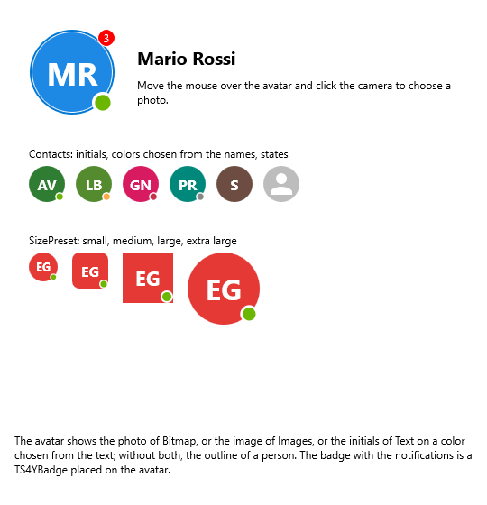

# TS4YAvatar for FireMonkey



The picture of a person, or the initials of the name on a colored background, as in the contact lists and the profiles of the apps.

- **Picture**: `Bitmap`, or the image `ImageIndex` of `Images`. The picture fills the shape and keeps its proportions: what goes beyond the shape is cut, in the same way on every side, so a wide or tall photo shows its middle.
- **Initials**: without a picture, the initials of `Text` (`Mario Rossi` gives `MR`) on a color chosen from the text, always the same for the same name, with white or dark letters, whichever is easier to read. `Initials` and `BackgroundColor` can replace them.
- **Outline of a person**: without picture and text.
- A circle, a square with rounded corners or a square, ready sizes or a free one, a ring around the avatar, a dot with the state of the person (online, away, busy, offline) and a camera button on the edge to change the picture.

Unit: `Soft4You.FMX.Controls.Avatar` (in `Sources\Avatar`), with its types in `Soft4You.FMX.Controls.Avatar.Types`.

## Installation

`TS4YAvatar` is part of the Soft4You FMX Control Suite. It is built into the runtime package `Soft4You.FMX.Controls.Suite`, and its registration into the design-time package `SuiteD`: see the README in the root of the repository. It appears in the Tool Palette page **Soft4You FMX Controls Suite**.

Add the folder `Sources\Avatar` to the Delphi library path to compile your own projects with the units.

## Files

| File | Content |
|---|---|
| `Sources\Avatar\Soft4You.FMX.Controls.Avatar.pas` | The control and the classes of its settings (`TS4YAvatarRing`, `TS4YAvatarEditButton`) |
| `Sources\Avatar\Soft4You.FMX.Controls.Avatar.Types.pas` | The enumerated types of the shape, the sizes, the states, the corners and the visibility of the edit button |
| `Sources\Avatar\Soft4You.FMX.Controls.Avatar.Register.pas` | Registration in the Tool Palette (design time) |
| `Sources\Avatar\Soft4You.FMX.Controls.Avatar.Win.rc` / `.Mac.rc` / `.Android.rc` / `.iOS.rc` | Resource scripts that link the style as the resource `S4YAvatarStyle` |
| `Sources\Avatar\Soft4You.FMX.Controls.Avatar.Win.style` / `.Mac.style` / `.Android.style` / `.iOS.style` | Default style of the avatar for each platform: they differ in the colors of the states and of the ring |
| `Graphics\Avatar\TS4YAvatar.svg` | Vector master of the icon of the Tool Palette |
| `Graphics\Avatar\TS4YAvatar.bmp`, `AvatarDesign.rc` | Icon of the Tool Palette (24x24 bitmap) and the resource script that links it |

The style resource is linked into the package, so the avatar looks the same without any other file. The packages compile it from the `.rc` file into the folder `Resources`, which your projects need in the library path.

## Properties

### Content

| Property | Default | Meaning |
|---|---|---|
| `Text` | empty | Name of the person, for example `Mario Rossi`: it gives the initials and the color of the background |
| `Initials` | empty | Initials shown without a picture; empty takes them from `Text`: the first letter of the first word and of the last one, in upper case, one letter for a single word |
| `Bitmap` | empty | Picture of the person; it wins over `ImageIndex` and the initials |
| `Images`, `ImageIndex` | none, -1 | Image list and index of the picture shown when `Bitmap` is empty; the list gives also the icon of the edit button |
| `BackgroundColor` | `Null` | Background of the initials; `Null` chooses a color from `Text` among twelve that can hold white letters |
| `InitialsColor` | `Null` | Color of the initials; `Null` chooses white or dark from the brightness of the background |

The size of the initials follows the size of the avatar (40% of its height); font and style come from the part `text` of the style.

### Shape and size

| Property | Default | Meaning |
|---|---|---|
| `Shape` | `avsCircle` | `avsCircle`, `avsRounded` (square with rounded corners) or `avsSquare` |
| `CornerRadius` | 8 | Radius of the corners of the picture with `avsRounded`, in pixels |
| `SizePreset` | `avzCustom` | `avzSmall` (32 pixels), `avzMedium` (40), `avzLarge` (56), `avzExtraLarge` (80); with a value other than `avzCustom` the avatar keeps that size whatever `Width` and `Height` are given. `avzCustom` keeps `Width` and `Height` |

A round avatar in a control that is not square is the largest circle in it, centered.

### Ring

| Property | Default | Meaning |
|---|---|---|
| `Ring.Visible` | `False` | Draws a ring around the avatar |
| `Ring.Color` | `Null` | Color of the ring; `Null` takes the one of the style |
| `Ring.Thickness` | 2 | Thickness of the ring, in pixels |
| `Ring.Gap` | 2 | Space between the ring and the picture, in pixels |

The ring is drawn inside the bounds of the avatar: the picture becomes smaller by `Thickness` plus `Gap` on every side.

### Status dot

| Property | Default | Meaning |
|---|---|---|
| `Status` | `avtNone` | `avtOnline`, `avtAway`, `avtBusy` or `avtOffline` show a dot of the color of the state; `avtNone` shows no dot |
| `StatusPosition` | `avcBottomRight` | Corner of the dot: `avcTopLeft`, `avcTopRight`, `avcBottomLeft`, `avcBottomRight` |
| `StatusColor` | `Null` | Color of the dot; `Null` takes the color of the state from the style |

The dot is a quarter of the size of the avatar, at least 8 pixels, with a border that separates it from the picture. On a round avatar the corner is the point of the circle in that direction.

### Edit button

A small round button on the edge of the avatar, with a camera icon, that lets the user change the picture.

| Property | Default | Meaning |
|---|---|---|
| `EditButton.Visibility` | `ebvNever` | `ebvNever`, `ebvAlways`, or `ebvOnHover`: shown while the mouse is over the avatar. On Android and iOS, which have no mouse, `ebvOnHover` shows the button always; in the form designer it is shown too |
| `EditButton.Position` | `avcBottomRight` | Corner of the button |
| `EditButton.SizeFactor` | 0.33 | Size of the button as a fraction of the size of the avatar, from 0.1 to 0.6 |
| `EditButton.ImageIndex` | -1 | Icon of the button in the `Images` of the avatar; -1 shows the camera icon of the style |
| `EditButton.BackgroundColor`, `IconColor` | `Null` | Colors of the button and of the camera icon; `Null` takes them from the style |
| `EditAction` | none | Action executed by the button (see below) |

When the status dot is in the same corner as the button, the button covers it while it is shown. On a desktop the mouse pointer becomes a hand over the button. On Android and iOS the button reacts to the finger in an area of at least 44 x 44 pixels, also when it is drawn smaller.

The usual `TControl` properties (`Align`, `Anchors`, `Position`, `Size`, `Margins`, `Opacity`, `Visible`, `Enabled`, `HitTest`, `Cursor`, `RotationAngle`, `Scale`, `PopupMenu`, `StyleLookup`, `TabOrder`, `TabStop`) are published too.

### Events

| Event | When |
|---|---|
| `OnEditClick` | The user clicks or taps the edit button |
| `OnChange` | The picture changes because of `EditAction` |
| `OnClick`, `OnDblClick`, `OnMouseXxx` | As for every control; a click on the edit button does not fire `OnClick` of the avatar |

## Changing the picture

The edit button fires `OnEditClick` and then executes `EditAction`, so the application can choose how the user gives the new picture:

- **On a desktop**, with `OnEditClick` and a `TOpenDialog`:

  ```delphi
  procedure TMainForm.ProfileAvatarEditClick(Sender: TObject);
  begin
    if PhotoOpenDialog.Execute then
      ProfileAvatar.Bitmap.LoadFromFile(PhotoOpenDialog.FileName);
  end;
  ```

- **On a phone**, with a `TTakePhotoFromLibraryAction` or a `TTakePhotoFromCameraAction` of a `TActionList` in `EditAction`: the photo taken becomes the `Bitmap` of the avatar by itself, and `OnChange` fires. The `OnDidFinishTaking` event of the action still fires. The avatar sets its own handler of `OnDidFinishTaking`, which calls the one the action had: an action of this kind is meant for one avatar, and its handler must not be changed by code afterwards.

  The two actions are not supported on Windows. On Android they need permissions declared in the project (*Project > Options > Application > Uses Permissions*) and granted by the user while the application runs, before the button is tapped: `READ_EXTERNAL_STORAGE` for the library, `CAMERA` and `WRITE_EXTERNAL_STORAGE` for the camera. Without them the action raises an exception. The application asks them with `PermissionsService.RequestPermissions`, for example when the page with the avatar is shown.

- **A menu**, for example camera, gallery or remove the photo, with `OnEditClick` showing a popup and executing the chosen action.

To remove the picture, empty the bitmap: `ProfileAvatar.Bitmap.SetSize(0, 0)`.

## Notification counter

A `TS4YBadge` placed on the avatar shows a counter of notifications: set its `AutoPosition.AutoPosition` to a corner, for example `bdgpUpRight`, and its `OffsetX` and `OffsetY` to `bdpoInner` to keep it on the edge of the circle.

```delphi
Badge := TS4YBadge.Create(Self);
Badge.Parent := ProfileAvatar;
Badge.AutoPosition.AutoPosition := bdgpUpRight;
Badge.AutoPosition.OffsetX := bdpoInner;
Badge.AutoPosition.OffsetY := bdpoInner;
Badge.CurrentValue := 3;
```

## Style

The avatar uses the style named by `StyleLookup` or, when it is empty or no style has that name, the one named `S4YAvatarStyle`, looked for in the `TStyleBook` of the form and in the active style. The style linked into the package is used when none of them has it; there is one for each platform, Windows, macOS, Android and iOS, which differ in the colors of the states and of the ring.

The avatar places and sizes the parts of the style itself, so they must be direct children of the root of the style. Every part is optional.

| Part | Class | Use |
|---|---|---|
| `background` | `TShape`, usually a `TRectangle` | Background of the initials and of the outline of a person; its fill color is the color behind the outline |
| `image` | `TRectangle` | The picture: the avatar fills it with the picture, cut to its proportions |
| `text` | `TText` | The initials: font, style and the default size; the avatar sets the size and the color |
| `placeholder` | any control, usually a `TPath` | The outline of a person, shown without picture and text |
| `ring` | `TRectangle` | The ring: its border color is the default color of `Ring.Color` |
| `status` | `TShape`, usually a `TCircle` | The status dot: the avatar sets its fill color; its border separates it from the picture |
| `editbutton` | any control, usually a `TCircle` | The edit button; a shape gets its fill color from `EditButton.BackgroundColor` |
| `editicon` | `TShape`, usually a `TPath`, child of `editbutton` | The camera icon |
| `editglyph` | `TGlyph`, child of `editbutton` | The icon taken from `Images` with `EditButton.ImageIndex` |
| `onlinecolor`, `awaycolor`, `busycolor`, `offlinecolor` | `TColorObject` | The colors of the states |
| `ringcolor` | `TColorObject` | The color of the ring, used instead of the border of `ring` |

The radius of the corners comes from `Shape` and `CornerRadius`, and the thickness of the borders of the dot and of the button follows their size. To change the look of all the avatars of an application, add to a style book a style named `S4YAvatarStyle`: the default style, `Sources\Avatar\Soft4You.FMX.Controls.Avatar.Win.style`, can be used as a model.

## Desktop and mobile

- The mouse: `ebvOnHover` shows the edit button only while the mouse is over the avatar, and the pointer becomes a hand over the button.
- The finger: no hover, so `ebvOnHover` shows the button always; the button reacts in an area of at least 44 x 44 pixels.
- The picture is prepared once for the size of the avatar and the scale of the screen, and used again until the picture, the shape or the size change, so that the avatar costs little to draw also in long lists on a phone.

## Demo

`Demos\Avatar\S4YAvatarDemo.dproj` (also part of the project group `Demos\Soft4You.FMX.Controls.Demos.groupproj`) shows a profile with a large avatar: a ring, a status dot, a badge with the notifications and the camera button, shown while the mouse is over it, that opens a photo from a file. Below it there are contacts with initials, colors and states, and the four ready sizes with the three shapes. The panel on the right changes the text, the initials, the shape, the state and its corner, the visibility and the corner of the edit button, the ring and the badge, and removes the photo.

The page **Avatar** of the mobile gallery `Demos\Mobile` has the profile with a `TTakePhotoFromLibraryAction` in `EditAction`: on the phone the camera button opens the gallery of the photos, and the photo chosen becomes the picture of the avatar.
