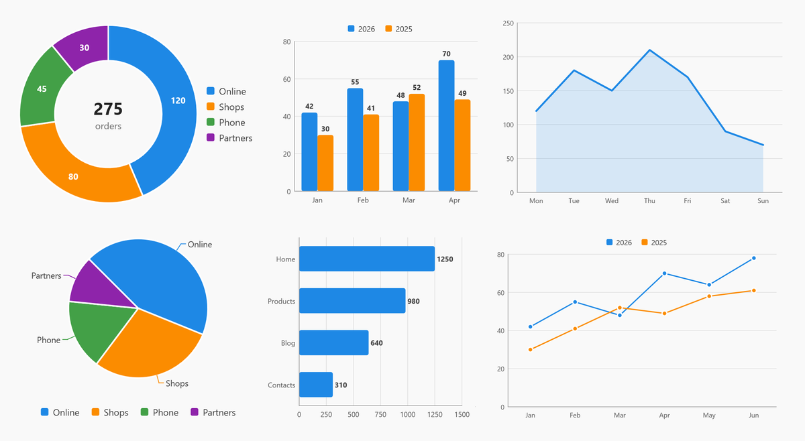

# Charts for FireMonkey



Charts drawn with the canvas of FireMonkey, with the look given by a style and the data given in the Object Inspector, in code or by the LiveBindings.

- `TS4YPieChart` draws the values as the slices of a **pie**, or of a **ring** with a hole in the middle.
- `TS4YBarChart` draws **bars**, vertical or horizontal: one for each category and each series, with the axes and the grid.
- `TS4YLineChart` draws a **line** for each series through its values in the categories, with points and, if wanted, the area under the line filled.
- A legend, the values or the percents written on the slices, and an animation when the chart appears and when its data change.
- A click on a slice, a bar or a point makes it the current one and fires an event.
- The data can come from a dataset or a list of objects through a standard `TLinkGridToDataSource`: see [LiveBindings](#livebindings).

Units: `Soft4You.FMX.Controls.Charts.Pie` for `TS4YPieChart`, `Soft4You.FMX.Controls.Charts.Bar` for `TS4YBarChart` and `Soft4You.FMX.Controls.Charts.Line` for `TS4YLineChart`, in `Sources\Charts`. The base class of the charts is in `Soft4You.FMX.Controls.Charts`, the one of the charts with categories and series in `Soft4You.FMX.Controls.Charts.Categories`, the types in `Soft4You.FMX.Controls.Charts.Types`, the support of the LiveBindings in `Soft4You.FMX.Controls.Charts.Bindings`.

## Installation

The charts are part of the Soft4You FMX Control Suite. They are built into the runtime package `Soft4You.FMX.Controls.Suite`, and their registration into the design-time package `SuiteD`: see the README in the root of the repository. They appear in the Tool Palette page **Soft4You FMX Controls Suite**.

Add the folder `Sources\Charts` to the Delphi library path to compile your own projects with the units, and the folder `Resources`, where the packages compile the default styles.

## Files

| File | Content |
|---|---|
| `Sources\Charts\Soft4You.FMX.Controls.Charts.pas` | `TS4YCustomChart`, the base class of the charts, with the palette and the legend |
| `Sources\Charts\Soft4You.FMX.Controls.Charts.Pie.pas` | `TS4YPieChart` and its slices |
| `Sources\Charts\Soft4You.FMX.Controls.Charts.Categories.pas` | `TS4YCustomCategoryChart`, base class of the bar and line charts, with categories, series and axes |
| `Sources\Charts\Soft4You.FMX.Controls.Charts.Bar.pas` | `TS4YBarChart` |
| `Sources\Charts\Soft4You.FMX.Controls.Charts.Line.pas` | `TS4YLineChart` |
| `Sources\Charts\Soft4You.FMX.Controls.Charts.Bindings.pas` | Support of `TLinkGridToDataSource`: grid editor and column manager of the charts |
| `Sources\Charts\Soft4You.FMX.Controls.Charts.Types.pas` | Enumerations and event types |
| `Sources\Charts\Soft4You.FMX.Controls.Charts.Register.pas` | Registration in the Tool Palette (design time) |
| `Sources\Charts\Soft4You.FMX.Controls.Charts.Pie.Win.rc` / `.Mac.rc` | Resource scripts that link the style of `TS4YPieChart` as the resource `S4YPieChartStyle` |
| `Sources\Charts\Soft4You.FMX.Controls.Charts.Pie.Win.style` / `.Mac.style` | Default style of `TS4YPieChart` (the two are identical) |
| `Sources\Charts\Soft4You.FMX.Controls.Charts.Bar.Win.rc` / `.Mac.rc` | Resource scripts that link the style of `TS4YBarChart` as the resource `S4YBarChartStyle` |
| `Sources\Charts\Soft4You.FMX.Controls.Charts.Bar.Win.style` / `.Mac.style` | Default style of `TS4YBarChart` (the two are identical) |
| `Sources\Charts\Soft4You.FMX.Controls.Charts.Line.Win.rc` / `.Mac.rc` | Resource scripts that link the style of `TS4YLineChart` as the resource `S4YLineChartStyle` |
| `Sources\Charts\Soft4You.FMX.Controls.Charts.Line.Win.style` / `.Mac.style` | Default style of `TS4YLineChart` (the two are identical) |
| `Graphics\Charts\TS4YPieChart.svg`, `TS4YBarChart.svg`, `TS4YLineChart.svg` | Vector masters of the icons of the Tool Palette |
| `Graphics\Charts\TS4YPieChart.bmp`, `TS4YBarChart.bmp`, `TS4YLineChart.bmp`, `ChartsDesign.rc` | Icons of the Tool Palette (24x24 bitmaps) and the resource script that links them |

## Properties of all the charts

| Property | Default | Meaning |
|---|---|---|
| `Legend.Position` | `clpRight` | Side of the chart with the legend: `clpTop`, `clpBottom` (entries in rows), `clpLeft`, `clpRight` (entries in a column) or `clpNone` |
| `Palette` | empty | Colors given in turn to the elements without a color of their own; empty, the colors come from the style (see [Colors](#colors)) |
| `ValueFormat` | `%.0f` | Format of the values written, as for the `Format` function of Delphi with the value as its only argument |
| `AnimationDuration` | 0.3 | Seconds the data take to grow when the chart appears, and to move to new values when they change; 0 changes them at once |
| `ItemIndex` | -1 | The current element (public, not in the Object Inspector): the slice of a pie, the category of a bar or line chart. A click on an element makes it the current one; with the LiveBindings it follows the current record |

| Event | Meaning |
|---|---|
| `OnItemClick` | Fires when the user clicks an element, after it has become the current one, with the index of the series (0 for a pie) and of the element |
| `OnGetValueText` | Fires when a value is written, with the value drawn, which follows the animation, and the text formatted with `ValueFormat`, which the event can replace. For a total `AItemIndex` is -1; for a label of the value axis both indexes are -1 |

These properties and events are public in the base class `TS4YCustomChart`, so that code can work on any chart through it. The usual `TControl` properties (`Align`, `Anchors`, `Position`, `Size`, `Margins`, `Padding`, `Opacity`, `Visible`, `Enabled`, `HitTest`, `Cursor`, `RotationAngle`, `Scale`, `PopupMenu`, `StyleLookup`) are published too.

### Colors

A slice or a series takes its own `Color` when it has one; with `claNull`, the default, it takes the color of the palette for its position: the first element the first color, and so on, starting again from the first color after the last one. The palette is `Palette` when it has colors, else the parts `color1` to `color8` of the style.

## TS4YPieChart

Each slice is as large as its part of the total. The slices follow clockwise from `StartAngle`.

| Property | Default | Meaning |
|---|---|---|
| `Slices` | empty | The slices stored in the form (see below) |
| `InnerRadius` | 0 | Radius of the hole in the middle, in percent of the radius, from 0 to 90: 0 is a pie, a larger value a ring |
| `StartAngle` | 0 | Angle where the first slice starts, in degrees: 0 is the top of the circle, 90 its right side |
| `LabelContent` | `plcPercent` | What is written on each slice: `plcNone`, `plcValue` (formatted with `ValueFormat`), `plcPercent` or `plcCaption` |
| `LabelPosition` | `plpInside` | `plpInside`: in the middle of the slice, only when the label fits in it. `plpOutside`: beside the slice, joined to it by a short line; the chart becomes smaller to leave room for the labels |
| `ShowTotal` | `False` | Writes the total of the values in the middle of a ring, formatted with `ValueFormat` |
| `CenterCaption` | empty | Text in the middle of a ring, under the total |

| Member | Meaning |
|---|---|
| `DrawnSliceCount`, `DrawnSlices[Index]` | The slices drawn: the ones of the LiveBindings while a link fills the chart, else the ones of `Slices`. `ItemIndex` and `OnItemClick` refer to them |
| `OnSliceBound` | Fires for each slice filled by the LiveBindings, after every update of the data (see [LiveBindings](#livebindings)) |

Each slice (`TS4YPieSlice`) has `Caption`, shown in the legend, `Value` (a negative value counts as 0), `Color` (`claNull`: the palette) and `Tag`, free for the application. A new chart is 300 x 200 pixels; the chart is as large as the area left by `Padding`, the legend and the labels outside allows.

```delphi
uses
  Soft4You.FMX.Controls.Charts.Types,
  Soft4You.FMX.Controls.Charts.Pie;

procedure TMainForm.ShowOrders;
begin
  OrdersChart.InnerRadius := 60;
  OrdersChart.ShowTotal := True;
  OrdersChart.CenterCaption := 'orders';
  OrdersChart.Slices.BeginUpdate;
  try
    OrdersChart.Slices.Clear;
    OrdersChart.Slices.Add('Online', 120);
    OrdersChart.Slices.Add('Shops', 80);
    OrdersChart.Slices.Add('Phone', 25);
  finally
    OrdersChart.Slices.EndUpdate;
  end;
end;
```

## TS4YBarChart

The values are organized in **categories**, for example the months, and **series**, for example this year and last year: each category has a value for each series. The bar chart draws a bar for each category and each series, the bars of a category side by side; the legend lists the series.

| Property | Default | Meaning |
|---|---|---|
| `Categories` | empty | The categories stored in the form, each with `Caption`, written along the category axis, its values and `Tag` |
| `Series` | empty | The series stored in the form, each with `Caption`, shown in the legend, `Color` (`claNull`: the palette) and `Tag` |
| `Orientation` | `Vertical` | Vertical bars, with the categories from left to right, or horizontal bars, with the categories from top to bottom |
| `BarWidth` | 70 | Space of a category taken by its bars, in percent, from 1 to 100 |
| `ShowValues` | `False` | Writes the value of each bar at its end, formatted with `ValueFormat` |
| `ValueAxis` | | The axis of the values: `Visible`, `GridLines` (lines across the chart at each step), `AutoRange`, `Min`, `Max` (see below) |
| `CategoryAxis` | | The axis of the categories: `Visible`, `GridLines` (default `False`; see below) |

| Member | Meaning |
|---|---|
| `DrawnCategoryCount`, `DrawnCategories[Index]` | The categories drawn: the ones of the LiveBindings while a link fills the chart, else the ones of `Categories`. `ItemIndex` refers to them |
| `DrawnSeriesCount`, `DrawnSeries[Index]` | The series drawn, in the same way |
| `OnSeriesBound`, `OnCategoryBound` | Fire for the series and the categories filled by the LiveBindings (see [LiveBindings](#livebindings)) |
| `OnItemClick` | Gives the series (`ASeriesIndex`) and the category (`AItemIndex`) of the clicked bar |

The values of a category are read and written in code with `Value[ASeriesIndex]`; a series without a value of its own in a category reads 0. In the Object Inspector they are the text `Values`, one value for each series separated by semicolons, with the point as decimal separator, for example `42;30.5`, whatever the language of the system.

With `ValueAxis.AutoRange = True`, the default, the scale goes from 0, or from the lowest value when it is negative, to the highest value, in steps of 1, 2, 2.5 or 5 times a power of 10, about five of them; a value that falls on the last step gets one step more, so that the values written beyond the bars stay inside the chart. With `AutoRange = False` the scale goes from `Min` to `Max`, and values out of it are drawn up to the edge. The bars start from 0, so negative values go the other way. The labels of the value axis are formatted with `ValueFormat` and pass through `OnGetValueText`, with both indexes -1.

`CategoryAxis.GridLines` draws lines across the chart for the categories, with the same look as the grid lines of the values: in a bar chart they separate the categories, in a line chart they go through the points of each category. It is off by default, while `ValueAxis.GridLines` is on.

```delphi
uses
  Soft4You.FMX.Controls.Charts.Categories,
  Soft4You.FMX.Controls.Charts.Bar;

procedure TMainForm.ShowSales;
begin
  SalesChart.Series.Clear;
  SalesChart.Series.Add('This year');
  SalesChart.Series.Add('Last year');
  SalesChart.Categories.BeginUpdate;
  try
    SalesChart.Categories.Clear;
    SalesChart.Categories.Add('Jan', [42, 30]);
    SalesChart.Categories.Add('Feb', [55, 41]);
    SalesChart.Categories.Add('Mar', [70, 52.5]);
  finally
    SalesChart.Categories.EndUpdate;
  end;
end;
```

## TS4YLineChart

The line chart has the same data and axes as the bar chart: `Categories`, `Series`, `ValueAxis`, `CategoryAxis`, `DrawnCategories`, `DrawnSeries`, `OnSeriesBound` and `OnCategoryBound` work in the same way. The categories go from left to right, and each value is a point in the middle of the space of its category; the line of a series joins its points.

| Property | Default | Meaning |
|---|---|---|
| `LineThickness` | 2 | Thickness of the lines, in pixels; with 0 only the points are drawn |
| `ShowPoints` | `True` | Draws a point on each value |
| `PointSize` | 8 | Diameter of the points, in pixels |
| `FillArea` | `False` | Fills the area under each line, down to the value 0, with the color of its series, partly transparent |

A click near a point, within its radius and a few pixels more, makes its category the current one and fires `OnItemClick` with the series and the category; the points are reached also when `ShowPoints` is `False`.

## LiveBindings

A chart is filled from a dataset or a list of objects with a standard **`TLinkGridToDataSource`**, as a grid: each record is a row of the chart, the first column of the link gives the captions of the rows, the next columns their values. For a pie, a row is a slice: the first column gives the captions, the second the values; further columns are not used. For a bar or line chart, a row is a category: the first column gives the captions of the categories, and **each next column is a series**, named after the `Header` of the column, or after its field when the header is empty.

In the LiveBindings Designer, link the data source to the chart as to a grid; or add a `TLinkGridToDataSource` to the bindings list, with `DataSource` set to the data source and `GridControl` to the chart, and add its columns: `MemberName` names the field of each column. Without columns, the link takes all the fields of the data source, in their order.

```delphi
// Sales by region, from a dataset with the fields Region and Amount.
SalesLink.DataSource := SalesBindSource;
SalesLink.GridControl := SalesChart;
SalesLink.Columns.Add.MemberName := 'Region';
SalesLink.Columns.Add.MemberName := 'Amount';
SalesLink.Active := True;
```

- **Two sets of data.** The slices, categories and series of the link are kept by the chart apart from `Slices`, `Categories` and `Series`: they are not stored in the form, also when the designer shows the data live, and the stored ones are not changed. While the link has columns the chart draws its data; when the link is freed or loses its columns, the chart draws the stored data again. As with a grid, a link made inactive leaves the last data in the chart.
- **Colors.** The slices and the series of the link take the colors of the palette by position. `OnSliceBound` fires for each slice after every update of the data, with the caption and the value of its record and `Color = claNull`: the event can give it a color, change its caption or set its tag. `OnSeriesBound` fires for each series when the link creates it from a column, and `OnCategoryBound` for each category after every update of the data, for example to change its caption.

  ```delphi
  procedure TMainForm.SalesChartSliceBound(Sender: TObject; const ASlice: TS4YPieSlice);
  begin
    // Regions under the target in red; the others keep the palette.
    if ASlice.Value < 20000 then
      ASlice.Color := TAlphaColors.Red;
  end;
  ```

- **Current record.** `ItemIndex` follows the current record of the data source, and a click on a slice, a bar or a point moves the current record to it: a grid or a form of details linked to the same data source follows the chart.
- **Units.** When the link is made in the IDE, the unit `Soft4You.FMX.Controls.Charts.Bindings` is added to the form; a link made in code needs only the unit of the chart, which uses it.

## Styles

The look of `TS4YPieChart` comes from a style named `S4YPieChartStyle`, a container of parts, which the chart reads and hides when the style is applied:

| Part (`StyleName`) | In the default style | Use |
|---|---|---|
| `color1` ... `color8` | `TRectangle` | The fill of each gives a color of the palette, when `Palette` is empty. The palette of the style ends at the first part missing |
| `slice` | `TRectangle` without fill, white border 2 pixels thick | Its `Stroke` is the border between the slices; with `Stroke.Kind = None` the slices touch |
| `labeltext` | `TText`, white, bold | Font and color of the labels inside the slices |
| `outerlabeltext` | `TText`, dark gray | Font and color of the labels outside the slices |
| `legendtext` | `TText` | Font and color of the legend |
| `centertext` | `TText`, bold, size 22 | Font and color of the total in the middle of a ring |
| `centercaptiontext` | `TText` | Font and color of `CenterCaption` |

The style linked into the package is used when no other style defines `S4YPieChartStyle`. To change the look of all the pie charts, select a pie chart in the form designer and choose Edit Custom Style in its menu: the IDE copies the style of the chart, with all its parts, into the `TStyleBook` of the form; rename the copy `S4YPieChartStyle` and clear the `StyleLookup` of the chart, or keep the name and the `StyleLookup` for a style of that chart only. The default style, `Sources\Charts\Soft4You.FMX.Controls.Charts.Pie.Win.style`, is also a text file that can be loaded into the style designer. The bar and line charts work in the same way.

In the default styles the parts are visible and laid out as a small chart, so that each part is seen and can be changed in the style designer: the palette in a row, the axis, a grid line, a bar or an area with a point, the texts with an example. Only the properties listed in the tables are read: the position, the size and the text of the parts do not matter, and neither does the fill of `bar`, `point` and `area`, which shows them in the style designer but is replaced by the colors of the series. The parts can also be hidden (`Visible = False`). A style with another name is used by the charts whose `StyleLookup` is set to that name; when no style has that name, they use `S4YPieChartStyle` as the others. The style of the parent class is never used. A missing text uses the default font and colors, a missing palette a palette of eight colors of its own.

### Style of the bar chart

The look of `TS4YBarChart` comes from a style named `S4YBarChartStyle`, with the parts `color1` to `color8` and `legendtext` as the pie chart, and:

| Part (`StyleName`) | In the default style | Use |
|---|---|---|
| `bar` | `TRectangle`, corners of 3 pixels, without border | The corners (`XRadius`) and the border (`Stroke`) of the bars, filled with the color of their series |
| `axis` | `TRectangle`, gray border | Its `Stroke` draws the lines of the axes |
| `gridline` | `TRectangle`, light gray border | Its `Stroke` draws the grid lines |
| `axistext` | `TText` | Font and color of the labels of the axes |
| `labeltext` | `TText`, bold | Font and color of the values written beyond the bars |

### Style of the line chart

The look of `TS4YLineChart` comes from a style named `S4YLineChartStyle`, with the parts `color1` to `color8`, `axis`, `gridline`, `axistext` and `legendtext` as the bar chart, and:

| Part (`StyleName`) | In the default style | Use |
|---|---|---|
| `point` | `TEllipse`, white border 2 pixels thick | Its `Stroke` is the border of the points, filled with the color of their series |
| `area` | `TRectangle`, `Opacity` 0.16 | Its `Opacity` is the transparency of the areas of `FillArea` |

## Demo

`Demos\Charts\S4YChartsDemo.dproj` (also part of the project group `Demos\Soft4You.FMX.Controls.Demos.groupproj`) shows a pie, a bar chart and a line chart, with the data stored in the form. The panel on the left changes the legend, the animation, `ValueFormat` and the palette of all the charts, sets random data to see the animation, and changes the properties of each chart: `InnerRadius`, `StartAngle`, `LabelContent`, `LabelPosition` and `ShowTotal` of the pie, `Orientation`, `BarWidth` and `ShowValues` of the bars, the axes of bars and lines, with their grid lines, `LineThickness`, `ShowPoints`, `PointSize` and `FillArea` of the lines. A label shows the element of the last click.

`Demos\Charts\S4YChartsGallery.dproj` (also in the project group) shows what the charts can look like, one example per tab: pies and rings; vertical, horizontal and negative bars; lines with two series and with the area filled; the styles of a `TStyleBook` (a pastel ring without borders, round bars with dashed grid lines, thick points); styles for a dark background; and the **LiveBindings**: a `TFDMemTable` linked by three `TLinkGridToDataSource` to a grid, a pie and a bar chart, with a navigator to add and delete records, `OnSliceBound`, `OnSeriesBound` and the current record that follows a click on the charts. The links and the styles are in the form and can be used as models.

Install the suite packages first.

## Notes

- The charts are indicators: they do not take the focus, and the user selects an element only with the mouse.
- With `AnimationDuration` greater than 0 the data grow from 0 the first time the chart is painted at run time. In the designer the changes are always immediate.
