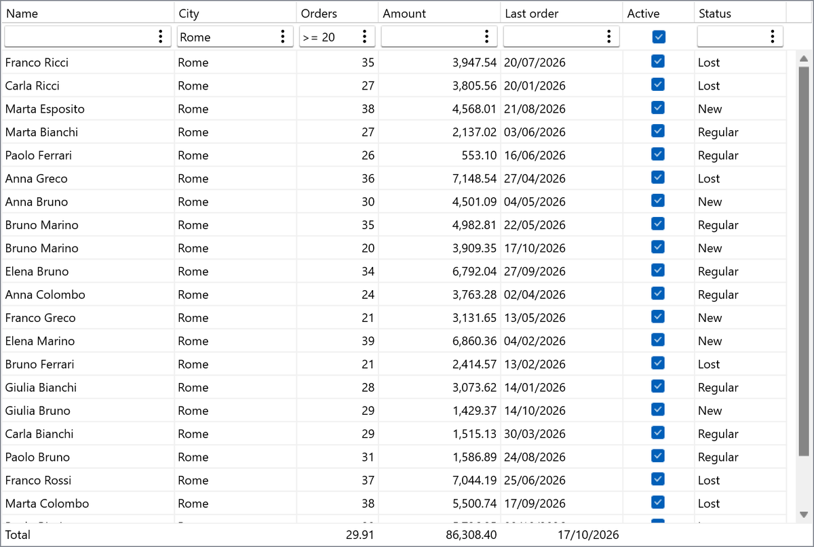

# TS4YGrid for FireMonkey



A grid with a **filter row** under the header: an editor for each column, where the user writes or chooses the value to look for in that column. The editor comes from the type of the column: a text box for a text column, a box that accepts only numbers for an integer, decimal or currency column, a date picker for a date column, a check box with three states for a check column, a drop-down list for a column with a list of values. The data can be filtered when the user presses Enter, or by themselves after a pause in the typing.

Under the cells, a **footer** can show a total, an average, a count, the lowest or the highest value, or a text, under each column.

A click on the header of a column can **sort** the rows by that column, and Shift+click by more columns; the header shows the arrow of the direction and the position of each column in the order.

`TS4YGrid` is a `TGrid`: the cells get their values from `OnGetValue` or from the LiveBindings, as in a `TGrid`, and every property, column and event of `TGrid` is there. The grid **does not filter or sort the data itself**: it keeps the filter values and the keys of the order and tells the application when to filter, with `OnFilter`, and when to sort, with `OnSort`; the application filters and sorts its own data, for example a list of objects or a `TDataSet`, and sets `RowCount` again.

The filter row and the footer take the look of the style of the grid, from the platform or from a `TStyleBook`: they are added to that style, not drawn with a style of their own.

Unit: `Soft4You.FMX.Controls.Grid`, in `Sources\Grid`.

## Installation

The grid is part of the Soft4You FMX Control Suite. It is built into the runtime package `Soft4You.FMX.Controls.Suite`, and its registration into the design-time package `SuiteD`: see the README in the root of the repository. It appears in the Tool Palette page **Soft4You FMX Controls Suite**.

Add the folder `Sources\Grid` to the Delphi library path to compile your own projects with the units.

## Files

| File | Content |
|---|---|
| `Sources\Grid\Soft4You.FMX.Controls.Grid.pas` | `TS4YGrid`, its model `TS4YGridModel`, the settings of the filter row (`TS4YGridFilterRow`), of the footer (`TS4YGridFooterRow`), of the order (`TS4YGridSorting`) and of the columns (`TS4YGridColumnSetting`, `TS4YGridColumnSettings`) |
| `Sources\Grid\Soft4You.FMX.Controls.Grid.Style.pas` | `TS4YStyledGrid`, the presentation that adds the filter row and the footer to the style of the grid and draws the arrows of the order in the header, and the rows themselves, `TS4YGridBand` and `TS4YGridFooterBand` |
| `Sources\Grid\Soft4You.FMX.Controls.Grid.FilterEditors.pas` | The editors of the filter row: `TS4YGridTextFilterEditor`, `TS4YGridNumberFilterEditor`, `TS4YGridDateFilterEditor`, `TS4YGridCheckFilterEditor`, `TS4YGridListFilterEditor` |
| `Sources\Grid\Soft4You.FMX.Controls.Grid.Types.pas` | The interface of the editors `IS4YGridFilterEditor`, what the footer shows (`TS4YGridFooterKind`), a key of the order (`TS4YGridSortKey`), the place of the position in the order (`TS4YGridSortOrderPosition`) and the event types |
| `Sources\Grid\Soft4You.FMX.Controls.Grid.Register.pas` | Registration in the Tool Palette (design time) |
| `Graphics\Grid\TS4YGrid.svg`, `TS4YGrid.bmp`, `GridDesign.rc` | Icon of the Tool Palette (vector master and 24x24 bitmap) and the resource script that links it |

## Filter row

| Property | Default | Meaning |
|---|---|---|
| `FilterRow.Visible` | `False` | Shows the filter row under the header |
| `FilterRow.Height` | 0 | Height of the row, in pixels; 0 is automatic: the height of the editors with the padding of the style (see [Styles](#styles)), at least the height of the rows of the grid |
| `FilterRow.ClearOnHide` | `False` | Clears the filters when the row is hidden, and fires `OnFilter`, so the application shows all its data again; `False` keeps them, and shows them again with the row |
| `FilterRow.AutoFilter` | `False` | Fires `OnFilter` by itself when the user stops typing in an editor of text, number or date for `FilterDelay` milliseconds; `False` filters only with Enter |
| `FilterRow.FilterDelay` | 400 | Milliseconds without typing after which `AutoFilter` fires `OnFilter`; 0 fires it at each change |

The row follows the columns: an editor has the width of its column, moves with it when the columns are moved or scrolled horizontally, and is hidden with it. The cells of the grid start under the row.

### Editors

| Type of the column | Editor | Value of the filter |
|---|---|---|
| `TIntegerColumn` | Text box that accepts only digits and the minus sign | `Int64` |
| `TFloatColumn`, `TCurrencyColumn` | Text box that accepts only digits, the minus sign and the decimal separator | `Double` |
| `TDateColumn` | Date picker with the button that clears the date | `TDate` |
| `TCheckColumn` | Check box with three states: any row (shown faded), checked rows, unchecked rows; a click passes to the next state | `Boolean` |
| `TPopupColumn`, or any column with `FilterItems` | Drop-down list with an empty item, which is no filter, and the items of the column or its `FilterItems` | `string`, the text of the item |
| Any other column, such as `TStringColumn` | Text box | `string` |

Every editor has an **empty** state, which means no filter for that column: no text, a text that is not yet a number (such as a minus sign alone), no date, the faded check box, the empty item of the list. **Esc** in an editor with a filter clears it and fires `OnFilter`; in a list it works with the list closed, since with the list open it closes the list.

The `FilterItems` of a column come before its type: a text column with a few possible values, such as *Open*, *Closed*, *Suspended*, can have a list instead of a text box.

To give a column an editor of your own, handle `OnCreateFilterEditor` and create a `TControl` that implements `IS4YGridFilterEditor`, the interface of the unit `Soft4You.FMX.Controls.Grid.Types`: the grid becomes its parent and frees it. The editors of the unit `Soft4You.FMX.Controls.Grid.FilterEditors` can be used as models, or as base classes.

### Settings of the columns

`ColumnSettings` is a collection, saved in the form, with the settings of the grid for some of its columns; a column without an item has the default settings.

| Property | Default | Meaning |
|---|---|---|
| `Column` | | The column of the grid the item is for |
| `Filterable` | `True` | Shows the editor of the column in the filter row |
| `FilterItems` | empty | The values the user can choose as filter of the column: when there are some, the editor is a drop-down list with them, whatever the type of the column |
| `FooterKind` | `gfkNone` | What the footer shows under the column (see [Footer](#footer)) |
| `FooterText` | empty | The text of the footer when `FooterKind` is `gfkText`, for example *Total* |
| `FooterFormat` | empty | Format of the value of the footer, as for the `Format` function of Delphi, for example `'%.2f'`; empty writes it as the column writes its cells |
| `FooterAlignment` | `Trailing` | Alignment of the text of the footer in the cell of the column |
| `Sortable` | `True` | Lets the user sort the rows by the column with a click on its header (see [Sorting](#sorting)) |

## Filter values

| Member | Meaning |
|---|---|
| `FilterValue[AColumn]` | The filter value of a column, a `TValue` of the type of the column; empty when the column has no filter. Setting it shows the value in the editor |
| `IsFiltered` | True when at least one column has a filter |
| `ClearFilters` | Clears the filters of all the columns |
| `Filter` | Fires `OnFilter` |

| Event | Fires |
|---|---|
| `OnFilterChanged(Sender, AColumn)` | When the filter value of a column changes, in its editor or by code |
| `OnFilter(Sender)` | When the application must filter its data: Enter or Esc in an editor, a choice in a list or a click on a check box of the row, the pause in the typing with `AutoFilter`, a call to `Filter`, the row hidden with `ClearOnHide` |
| `OnCreateFilterEditor(Sender, AColumn, var AEditor)` | When the grid creates the editor of a column: an editor of your own instead of the one of the grid |

The meaning of a value is decided by the application: for a text it is usually "contains", for a number or a date "equal". Typing in an editor fires `OnFilterChanged` at each change, but `OnFilter` only with Enter, or with `AutoFilter` after a pause, so the data are not filtered again at each key; each key starts the pause again. A choice in a list and a click on a check box are explicit, and filter at once.

## Footer

| Property | Default | Meaning |
|---|---|---|
| `FooterRow.Visible` | `False` | Shows the footer under the cells, over the horizontal scroll bar |
| `FooterRow.Height` | 0 | Height of the footer, in pixels; 0 is the height of the rows of the grid, plus the top and bottom padding of the style (see [Styles](#styles)) |

What the footer shows under each column is in `ColumnSettings`, with `FooterKind`:

| `FooterKind` | Shows |
|---|---|
| `gfkNone` | Nothing |
| `gfkSum` | The sum of the values of the rows |
| `gfkAverage` | The average of the values of the rows |
| `gfkCount` | The number of rows with a value |
| `gfkMin` | The lowest value, also of a date column |
| `gfkMax` | The highest value, also of a date column |
| `gfkText` | The text `FooterText` |

The values are read from the **rows of the grid**, the ones of `RowCount`, in the same way as the cells: from `OnGetValue` or from the LiveBindings. After the application has filtered its data and set `RowCount` again, the footer shows the totals of the rows shown. A value that is a number, or a text that is a number, is counted in the sum, the average and the extremes; any value that is not empty is counted by `gfkCount`. The value is written as the column writes its cells, with its decimals and its separator of the thousands, or with `FooterFormat`; the average of an integer column keeps two decimals.

The footer is calculated again when the number of rows changes, when a cell is edited in the grid and when the settings change. A `TGrid` does not see the changes of the data of the application: after one, call `UpdateFooter`.

| Member | Meaning |
|---|---|
| `UpdateFooter` | Calculates and draws the footer again |
| `OnGetFooterText(Sender, AColumn, var AText)` | Fires for each visible column with the text calculated, which the application can change: for example the total of all its data and not only of the rows shown, or a calculation of its own |

With the LiveBindings on a `TDataSet` (a `TLinkGridToDataSource`), the values of all the rows are read through the link: in the demo the footer of 200 rows of a `TFDMemTable` is calculated in a few milliseconds, and the current record of the data set does not move. On large data sets prefer `OnGetFooterText` with the totals calculated by the data set.

## Sorting

With `Sorting.Enabled`, a click on the header of a column chooses the order of the rows. The order can have more **keys**: the rows are sorted by the first column, then, where the values of the first column are the same, by the second, and so on.

| Gesture | Effect |
|---|---|
| Click | Sorts only by the column; when the rows are already sorted only by it, inverts the direction |
| Shift+click | Adds the column as the next key; when it is already a key, inverts its direction and leaves the other keys |
| Ctrl+click (Cmd+click on macOS) | Removes the column from the order |
| Alt+click | Removes all the keys: back to the order of the data |

The header of each key shows an arrow, pointing up from the lowest value to the highest and down from the highest to the lowest; with more keys, also the position of the column in the order (1, 2, 3...), on the left of the arrow by default. The text of the header leaves the space for them. Moving a column by dragging its header does not change the order.

| Property | Default | Meaning |
|---|---|---|
| `Sorting.Enabled` | `False` | Lets the user choose the order with a click on the header |
| `Sorting.MultiColumn` | `True` | Lets Shift+click sort by more columns; `False` makes Shift+click a click |
| `Sorting.ShowOrder` | `True` | Shows the position of each column in the order when there are more keys |
| `Sorting.OrderPosition` | `gopBefore` | Where the position is shown: `gopBefore` on the left of the arrow, `gopAfter` on the right |
| `Sorting.OrderSpacing` | 3 | Space between the position and the arrow, in pixels |

The grid **does not sort the data itself**: as for the filters, it keeps the keys and fires `OnSort`, and the application sorts its data, for example a list of objects with a comparer that reads the keys, or a `TFDMemTable` with `IndexFieldNames` (`'City;Amount:D'`). With `OnGetValue`, call `Model.ClearCache` after sorting, as after a filter. The filters and the order are independent: an application that does both can filter its data and then sort them in one procedure, called by `OnFilter` and `OnSort`.

| Member | Meaning |
|---|---|
| `SortCount` | The number of keys; 0 when the rows have the order of the data |
| `SortColumn[I]`, `SortDescending[I]` | The column and the direction of each key, the first key first |
| `SortIndexOf(AColumn)` | The position of a column among the keys, -1 when it is not a key |
| `IsSorted` | True when there is at least one key |
| `SetSort(AColumn, Descending)` | Sorts only by a column |
| `AddSort(AColumn, Descending)` | Adds a column as the last key, or changes its direction when it is already a key |
| `RemoveSort(AColumn)` | Removes a column from the keys |
| `ClearSort` | Removes all the keys |
| `OnSort(Sender)` | When the order changes, with a click or by code: the application sorts its data |

The methods work also when `Sorting.Enabled` is `False`, and the header shows the order they set; `Sortable` and `Enabled` are only about the clicks. The key of a column removed from the grid is forgotten without `OnSort`: the LiveBindings create the columns again when the link changes, so sort again after such a change. The clicks need the option `HeaderClick` or `ColumnMove` in `Options`, as the `OnHeaderClick` of `TGrid`, which still fires.

## Demo

`Demos\Grid\S4YGridDemo.dproj` (also part of the project group `Demos\Soft4You.FMX.Controls.Demos.groupproj`) has three tabs:

- **Objects**: 200 customers in a list of objects, shown with `OnGetValue` and filtered by the application in `OnFilter`, with a drop-down list for the city (`FilterItems`) and a footer with a text, an average, a sum and a date; the panel on the left changes the filter row (`Visible`, `AutoFilter`, `FilterDelay`, `ClearOnHide`, `ClearFilters`) and the footer (`Visible`, the `FooterKind` of the amount, the sum of all the data with `OnGetFooterText`) and the order (`Sorting.Enabled`, `MultiColumn`, `ShowOrder`, `OrderPosition`, `OrderSpacing`), and shows the last `OnFilterChanged`, the rows shown and the keys of the last `OnSort`; the application sorts the list with a comparer that reads the keys, after the filters;
- **LiveBindings**: the same customers in a `TFDMemTable`, shown through a `TLinkGridToDataSource` and filtered by the data set in `OnFilterRecord` and sorted with its `IndexFieldNames` in `OnSort`, with the footer read through the link;
- **Style book**: the grid with a dark style of the `TStyleBook` of the form, with the parts `filterrowbackground`, `footerbackground` and `footertext`.

Install the suite packages first.

## Example

A list of objects shown with `OnGetValue`, filtered by the application:

```pascal
procedure TMainForm.GridFilter(Sender: TObject);
var
  LName: TValue;
begin
  LName := Grid.FilterValue[NameColumn];
  FVisible.Clear;

  for var LCustomer in FCustomers do
    if LName.IsEmpty or LCustomer.Name.Contains(LName.AsString) then
      FVisible.Add(LCustomer);

  // As in any TGrid, the values already shown are cleared: the rows are now other customers.
  Grid.Model.ClearCache;
  Grid.RowCount := FVisible.Count;
  Grid.Repaint;
  Grid.UpdateFooter;
end;

procedure TMainForm.GridGetValue(Sender: TObject; const ACol, ARow: Integer; var Value: TValue);
begin
  if ACol = NameColumn.Index then
    Value := FVisible[ARow].Name;
end;
```

## LiveBindings

A `TLinkGridToDataSource` fills a `TS4YGrid` as a `TGrid`: it creates a column for each field, of the type of the field (`TStringColumn`, `TIntegerColumn`, `TCurrencyColumn`, `TDateColumn`, `TCheckColumn` and so on), so the filter row gets the editors of those types. The columns created by the link are not in the form: their `ColumnSettings` are added in code, after the link is active, for example in `OnCreate` of the form, finding the columns by their `Header`, which is the name of the field.

The application filters the data set in `OnFilter`, for example with its `Filtered` property and `OnFilterRecord`, reading the filter values of the grid; the link shows the records that pass, and the footer is calculated again.

## Styles

The filter row is added to the style of the grid when the style is applied: to the part `background`, aligned to the top after the header, so the part `content` with the cells starts under it. The row draws a line on its bottom side with the brush `linefill` of the style, the brush of the lines of the grid, and its editors take the styles of `TEdit`, `TDateEdit`, `TCheckBox` and `TComboBox`.

The footer is added in the same way, aligned to the bottom over the horizontal scroll bar, with a line on its top side; its texts have the font and the color of the text of the grid.

A style of the grid in a `TStyleBook` can add these parts, all optional:

| Part | Use |
|---|---|
| `filterrowbackground` | Any control: the background of the filter row; its `Padding` is the space between the editors and the sides of their cells |
| `footerbackground` | Any control: the background of the footer; its `Padding` is a space around the texts of all the cells, besides the `Padding` of the columns |
| `footertext` | A `TText`: the font and the color of the texts of the footer |
| `sortindicator` | A `TText`: the color of the arrows of the order and the font of the positions in the order; without it, the color of the text of the header and a smaller font |

The texts of the footer are placed in their cells as the texts of the cells of the grid: in the cell less the `Padding` of the column (a published property of `TColumn`, 3 pixels on each side by default), so a total is aligned with the values above it. When a style has the part `filterrowbackground` or `footerbackground`, its `Padding` is always used, also when it is 0: a style that adds `filterrowbackground` sets its `Padding` too, for example 2 on each side. Without the part, as in the styles of the platform, the editors are 2 pixels from the sides of their cells, and the texts of the footer have only the `Padding` of the columns. The top and bottom padding of the parts are added to the automatic heights; a `Height` greater than 0 comes first, and the editors and the texts take the space left inside the padding.

A style without the part `background` has no filter row and no footer.
