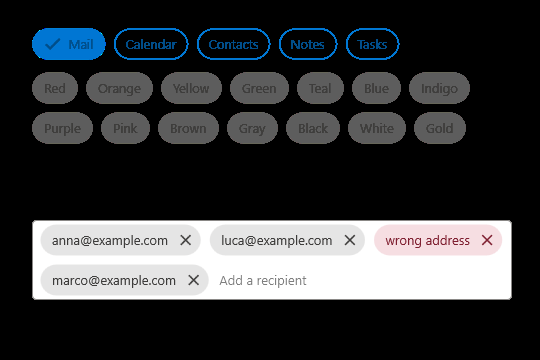

# TS4YTag, TS4YChip, TS4YChipGroup and TS4YChipEdit for FireMonkey


Two small labels, a short text on a colored background that follows the text, with an icon or a picture on the left and a close button on the right:

- **`TS4YTag`** classifies: *Urgent*, *Draft*, *Delivered*. It does not react to the mouse or the keyboard, except for its close button.
- **`TS4YChip`** is chosen by the user: a filter, a choice among a few, a recipient that can be removed. It reacts to the mouse (hover and press), to the finger and to the keyboard, can be chosen alone or in a group, and can be closed.

Both come from the same base, `TS4YCustomTag`: six meanings (`Kind`) that give the color, three ways to fill it (`Variant`), three shapes, three sizes, the colors from the style, and the same parts of the style.

Two controls hold chips:

- **`TS4YChipGroup`** makes chips from a list of texts, of which the user chooses one, some or none.
- **`TS4YChipEdit`** is a text field where each entry becomes a chip, as the recipients of an email.

Both wrap the chips on new lines and scroll when a `MaxHeight` is reached. They come from `TS4YCustomChipBox`, a scroll box that keeps a chip for each text of `Items`.



Units: `Soft4You.FMX.Controls.Tag` (the base and `TS4YTag`), `Soft4You.FMX.Controls.Chip` (`TS4YChip`), `Soft4You.FMX.Controls.ChipBox`, `Soft4You.FMX.Controls.ChipHost`, `Soft4You.FMX.Controls.ChipGroup` and `Soft4You.FMX.Controls.ChipEdit`, in `Sources\Tag`, with the types in `Soft4You.FMX.Controls.Tag.Types`.

## Installation

`TS4YTag`, `TS4YChip`, `TS4YChipGroup` and `TS4YChipEdit` are part of the Soft4You FMX Control Suite. They are built into the runtime package `Soft4You.FMX.Controls.Suite`, and their registration into the design-time package `SuiteD`: see the README in the root of the repository.

Add the folder `Sources\Tag` to the Delphi library path to compile your own projects with the units.

## Files

| File | Content |
|---|---|
| `Sources\Tag\Soft4You.FMX.Controls.Tag.pas` | `TS4YCustomTag` (the base, with the protected properties) and `TS4YTag` |
| `Sources\Tag\Soft4You.FMX.Controls.Chip.pas` | `TS4YChip` |
| `Sources\Tag\Soft4You.FMX.Controls.ChipBox.pas` | `TS4YCustomChipBox`: the scroll box that keeps a chip for each text and wraps them, base of the group and the edit |
| `Sources\Tag\Soft4You.FMX.Controls.ChipHost.pas` | `TS4YCustomChipHost`: the control with a style that holds the box of chips and takes the look of the chips from the part `chip` of the style, base of the group and the edit |
| `Sources\Tag\Soft4You.FMX.Controls.ChipGroup.pas` | `TS4YChipGroup` |
| `Sources\Tag\Soft4You.FMX.Controls.ChipEdit.pas` | `TS4YChipEdit` |
| `Sources\Tag\Soft4You.FMX.Controls.Tag.Types.pas` | The enumerated types of the kind, the variant, the shape, the size, the state and the selection mode, the heights and font sizes of the sizes, and the types of the events |
| `Sources\Tag\Soft4You.FMX.Controls.Tag.Register.pas` | Registration of the four controls in the Tool Palette (design time) |
| `Sources\Tag\Soft4You.FMX.Controls.Tag.Win.rc` / `.Mac.rc` / `.Android.rc` / `.iOS.rc`, and the same for `Chip`, `ChipGroup` and `ChipEdit` | Resource scripts that link the styles as the resources `S4YTagStyle`, `S4YChipStyle`, `S4YChipGroupStyle` and `S4YChipEditStyle` |
| `Sources\Tag\Soft4You.FMX.Controls.Tag.Win.style` / `.Mac.style` / `.Android.style` / `.iOS.style`, and the same for `Chip`, `ChipGroup` and `ChipEdit` | Default styles for each platform: they differ in the colors of the kinds and of the frame, and in the size of the chips |
| `Graphics\Tag\TS4YTag.svg`, `TS4YChip.svg`, `TS4YChipGroup.svg`, `TS4YChipEdit.svg` | Vector masters of the icons of the Tool Palette |
| `Graphics\Tag\TS4YTag.bmp`, `TS4YChip.bmp`, `TS4YChipGroup.bmp`, `TS4YChipEdit.bmp`, `TagDesign.rc` | Icons of the Tool Palette (24x24 bitmaps) and the resource script that links them |

The style resources are linked into the package, so the controls look the same without any other file. The packages compile them from the `.rc` files into the folder `Resources`, which your projects need in the search path of the resources, as for the other controls of the suite.

## Properties

### Content

| Property | Default | Meaning |
|---|---|---|
| `Text` | empty | The text; at design time a new control shows its name, as a label does, until a text is written |
| `Images`, `ImageIndex` | none, -1 | Image list and index of the icon on the left |
| `Bitmap` | empty | Picture on the left, for example the photo of a person; it wins over the icon. It is cut to a square, from its middle |
| `ImageRound` | `False` | Draws the `Bitmap` round instead of with slightly rounded corners |
| `Closable` | `False` | Shows a close button, a cross, on the right |

### Look

| Property | Default | Meaning |
|---|---|---|
| `Kind` | `tgkNeutral` | The meaning, that gives the color: `tgkNeutral` (gray), `tgkPrimary` (blue), `tgkSuccess` (green), `tgkWarning` (orange), `tgkDanger` (red), `tgkInfo` (light blue) |
| `Variant` | `tgvTonal` (`tgvOutlined` for a chip) | `tgvFilled`: the background has the color and the text is white or dark; `tgvTonal`: a light background of the color and text of the color; `tgvOutlined`: no background, a border and text of the color |
| `Shape` | `tgsPill` | `tgsPill` (the short sides are half circles), `tgsRounded` (corners with the radius of `CornerRadius`), `tgsSquare` |
| `CornerRadius` | 6 | Radius of the corners with `tgsRounded`, in pixels |
| `SizePreset` | `tgzMedium` | `tgzSmall` (24 pixels high), `tgzMedium` (32), `tgzLarge` (40); on Android and iOS the default is `tgzLarge`. With `tgzCustom` the height is the one set in `Height`, from 16 pixels |
| `TextSettings` | | The font of the text: `Font.Family` and `Font.Style` (bold, italic) for the settings that are not in `StyledSettings`. `Font.Size` is not used, see below. Only `Font` is published: the color comes from `Kind` and `Variant`, and the control places and trims the text itself |
| `StyledSettings` | all but `Size` | Which settings of the font come from the part `text` of the style and which from `TextSettings`, as in a `TLabel`. With `Family` or `Style` in it the font is the one of the style |
| `HorizontalPadding` | 0 | Space at the left and at the right of the content in pixels; 0 takes it from the height |
| `AutoSize` | `True` | The width follows the content: the text, the icon and the close button. With `False` the width is the one set, and a text that does not fit is cut, with an ellipsis |
| `MaxWidth` | 0 | Largest width in pixels when `AutoSize` is `True`: a text that would make the control wider is cut, with an ellipsis. 0 means no limit; the control is never narrower than its height |
| `BackgroundColor`, `TextColor`, `BorderColor` | `Null` | Colors that replace the ones that come from `Kind` and `Variant`; `Null` keeps them |

The height follows `SizePreset`, or `Height` with `tgzCustom`; the font and the spaces follow the height (the font is 11, 13 and 15 points at 24, 32 and 40 pixels, and goes on in the same line, never under 8 points). The size of the font follows the height unless `Size` is in `StyledSettings` or the control has a style of its own (`StyleLookup` that is not the default one): then it is the size of the part `text` of the style. The family and the style of the font come from the part `text` of the style, or from `TextSettings` when they are not in `StyledSettings`: a tag in italic needs `Style` out of `StyledSettings` and `Font.Style` with italic.

### Events

| Event | When |
|---|---|
| `OnClose` | The user clicks the close button, or presses Delete or Backspace on a focused chip. `CanClose` is `True`: set it to `False` to keep the control, which is hidden otherwise |
| `OnClick`, `OnDblClick`, `OnMouseXxx` | As for every control; a click on the close button does not fire `OnClick` |

The usual `TControl` properties (`Align`, `Anchors`, `Position`, `Size`, `Margins`, `Opacity`, `Visible`, `Enabled`, `HitTest`, `Cursor`, `RotationAngle`, `Scale`, `PopupMenu`, `StyleLookup`) are published as well; `TabOrder` and `TabStop` only for the chip. A disabled control is drawn with half of its opacity.

### `TS4YChip`

| Property | Default | Meaning |
|---|---|---|
| `Checkable` | `False` | A click chooses and un-chooses the chip |
| `Checked` | `False` | The chip is chosen |
| `GroupName` | empty | Chips with the same name in the same parent are a group of which only one is chosen, as with radio buttons; clicking the chosen one keeps it chosen |
| `ShowCheckMark` | `True` | A chosen chip shows a check mark in place of its icon or picture |
| `OnCheckedChange` | | After `Checked` changes: for a click, the keyboard, the code, or another chip of the group that was chosen |

- A chosen chip is drawn with the next stronger variant (outlined becomes tonal, tonal becomes filled, filled stays filled) and with the check mark. The width can change, because of the check mark.
- States: hover (not on Android and iOS), pressed, and, on the desktop, a focus border.
- Keyboard: the chip takes the focus; Space clicks it; Delete or Backspace close it when `Closable` is `True`.
- The cursor is a hand by default.
- Changing `Checked` from the code fires `OnCheckedChange` but not `OnClick`.

## Closing

The close button fires `OnClose` and then hides the control (`Visible := False`), so that a flow layout closes the gap. To keep it, set `CanClose := False`; to remove it for good, free it later (not inside the event), for example with `TThread.ForceQueue`.

```delphi
procedure TMainForm.RecipientChipClose(Sender: TObject; var CanClose: Boolean);
begin
  Recipients.Remove(TS4YChip(Sender).Text);
end;
```

## `TS4YChipGroup`

Chips made from a list of texts, one after the other and on a new line when the width ends, of which the user chooses one, some or none. `Items` holds the texts; the group makes, changes and frees the chips (they are not saved in the form) and gives them `Kind`; their look comes from the style.

| Property | Default | Meaning |
|---|---|---|
| `Items` | empty | The texts of the chips, one for each chip. Changing the list keeps the choice of the chips that remain, by position |
| `SelectionMode` | `cgmSingle` | `cgmSingle`: one chip at a time, as radio buttons, and clicking the chosen one keeps it chosen; `cgmMultiple`: any number; `cgmNone`: the chips are not chosen |
| `ItemIndex` | -1 | Position of the chosen chip, or of the first chosen one in `cgmMultiple`; -1 for none. Setting it chooses that chip and un-chooses the others. It is saved in the form only in `cgmSingle` |
| `Selected[Index]` | | Whether the chip at that position is chosen (read and write) |
| `SelectedItems` | | The texts of the chosen chips, in the order of `Items` (read only) |
| `Kind`, `ShowCheckMark` | neutral, `True` | Color of all the chips and check mark of a chosen chip. The size, the font, the variant and the rest of the look come from the chip of the style (see below) |
| `HorizontalGap`, `VerticalGap` | 8 | Space between two chips, and between two lines, in pixels |
| `AutoSize` | `True` | The height follows the lines of chips, up to `MaxHeight` |
| `MaxHeight` | 0 | Largest height in pixels when `AutoSize` is `True`: a longer content scrolls vertically, with the mouse wheel and the finger. 0 means no limit |
| `OnChange` | | After the choice changes, whether by the user, by `ItemIndex` or by `Selected` |

With `AutoSize` set to `False` the height is the one set, and the group scrolls when the chips do not fit.

Keyboard: Tab enters the group on one chip, the chosen one in `cgmSingle` or else the first, and goes on to the next control; the arrow keys, Home and End move the focus among the chips (up and down go to the nearest chip of the line above or under), and Space chooses the chip. The chip that takes the focus is scrolled into view.

Binding: a property link (`TLinkPropertyToField`) can show a field in `ItemIndex`, and the group follows the source. The other way, from the group to the source, is not done by the link: assign the field in `OnChange`. The texts of `Items` cannot be filled by the list links of LiveBindings (`TLinkListControlToField` stops with the error *No list control editor available*: it needs a list control that FMX knows), so fill `Items` in the code.

## `TS4YChipEdit`

A text field where the user types entries that become chips, as the recipients of an email: the chips and the text field share the lines, which wrap at the width of the control. The look is a frame, with the chips of `TS4YChip` (closable) inside it.

| Property | Default | Meaning |
|---|---|---|
| `Items` | empty | The texts of the chips, in order. Changing it from the code changes the chips but fires no event |
| `Separators` | `,;` | The characters that turn the text into a chip, besides Enter |
| `AllowDuplicates` | `False` | When `False`, a text that is already an item (without case) is dropped |
| `MaxItems` | 0 | The most chips the control holds; a text that would be one more stays in the field. 0 means no limit |
| `TextPrompt` | empty | Text shown in the field while it is empty |
| `Kind` | neutral | Color of the chips. The size, the font, the variant and the rest of the look come from the chip of the style (see below); the text field is as high as the chips and has their font |
| `HorizontalGap`, `VerticalGap` | 8 | Space between two chips, and between two lines, in pixels |
| `AutoSize` | `True` | The height is the one of the lines, up to `MaxHeight`: the height set in the designer or in the code is replaced by it. With `False` the height is the one set, the chips keep their height and start from the top, and what does not fit is clipped inside the frame and scrolls |
| `MaxHeight` | 0 | Largest height in pixels, frame included, when `AutoSize` is `True`: a longer content scrolls. 0 means no limit |
| `EditText` | | The text that the user is typing, not yet a chip; setting it works as typing or pasting it |

| Method | Does |
|---|---|
| `AddItem(Text)` | Turns a text into a chip as Enter does: the spaces around it are dropped, `OnValidate` is called, `OnAdd` fires. Returns `False` when the text is refused |
| `CommitText` | Turns the text of the field into a chip |
| `RemoveItem(Index)` | Removes the chip and fires `OnRemove` |
| `FocusEdit` | Gives the focus to the text field |

| Event | When |
|---|---|
| `OnValidate(Sender, Text, Accept, Kind)` | Before a text becomes a chip. Set `Accept` to `False` to refuse it: it stays in the field. Set `Kind`, for example to `tgkDanger` for an address that is not valid, to accept it and show it differently; the kind is kept with the item |
| `OnAdd(Sender, Text, Index)` | After a chip is added by the user, `AddItem` or `CommitText` |
| `OnRemove(Sender, Text, Index)` | After a chip is removed by the user or `RemoveItem` |

How the user works:

- Enter, a separator, the loss of the focus, and a paste with separators in it turn the text into chips; a text that is only spaces gives no chip.
- Tab goes through the text field only; the chips are reached with the arrow keys.
- Backspace with the field empty removes the last chip. The left arrow with the cursor at the start of the field moves the focus to the last chip, the arrow keys move it among the chips and the field, and Delete or Backspace on a chip removes it, as its close button does. The chip that takes the focus is scrolled into view.
- A click on the free space of the control puts the cursor in the field.

```delphi
procedure TMainForm.RecipientsEditValidate(Sender: TObject; const Text: string; var Accept: Boolean;
  var Kind: TS4YTagKind);
begin
  // The text is accepted, and an address that does not look right is shown as a danger
  if Pos('@', Text) < 2 then
    Kind := tgkDanger;
end;
```

The frame comes from the style `S4YChipEditStyle` (see below). The text field uses the style `transparentedit` of the active style, for its font and its colors; the control hides the `background` part of that style, so the field has neither a frame nor a focus rectangle of its own, and the frame of the control shows the focus.

## Style

`TS4YTag` uses the style named by `StyleLookup` or, when it is empty or no style has that name, the one named `S4YTagStyle`; `TS4YChip` the one named `S4YChipStyle`. The style is looked for in the `TStyleBook` of the form, then in the active style, and the one linked into the package is the last resort. The two default styles are the same, except for the name.

The controls place and size the parts of the style themselves, so they must be direct children of the root of the style. Every part is optional.

| Part | Class | Use |
|---|---|---|
| `background` | `TRectangle` | The background: the control sets its color, its border and its radius |
| `image` | `TRectangle` | The picture (`Bitmap`) |
| `icon` | `TGlyph` | The icon taken from `Images` with `ImageIndex` |
| `check` | `TShape`, usually a `TPath` | The check mark of a chosen chip |
| `text` | `TText` | The text: font family and style; the control sets the size and the color |
| `close` | `TShape`, usually a `TCircle` | The close button: its area reacts to the mouse and to the finger; the control draws a round background on it while the mouse is over |
| `closeicon` | `TShape`, usually a `TPath`, child of `close` | The cross |
| `neutralcolor`, `primarycolor`, `successcolor`, `warningcolor`, `dangercolor`, `infocolor` | `TColorObject` | The colors of the kinds |
| `neutraltextcolor`, `primarytextcolor`, `successtextcolor`, `warningtextcolor`, `dangertextcolor`, `infotextcolor` | `TColorObject` | The colors of the text and of the icons of the tonal and outlined variants. Optional: without them the control uses the color of the kind made darker |

The colors of the background, the border and the text are calculated from the color of the kind and the variant: filled uses the color and a white or dark text, whichever is easier to read; tonal uses the color at 16 percent and the text color of the kind; outlined uses the color for the border and the text color of the kind. The text color of a kind is the one of the part `...textcolor` of the style and, when the style has none, the color of the kind made 35 percent darker. The states hover and pressed make a filled background darker and a tonal or outlined one more opaque.

### Dark styles

The tonal and outlined variants draw their text with a dark version of the color, which is easy to read on a light background and not on a dark one. For a dark style, give the parts `...textcolor` lighter colors: in a `TStyleBook` with a copy of `S4YTagStyle` and `S4YChipStyle` (*Edit Custom Style* in the form designer, or the style files of `Sources\Tag` as a start), change the `Color` of `primarytextcolor` and of the others, for example to the color of the kind made lighter. The default styles give the values the controls calculate, so they look the same as without these parts. `TextColor` still replaces them for a single control.

### The chips of the group and the edit

The group and the edit do not publish the look of their chips (size, font, padding, shape, variant, corner radius, style). It comes from their style, as the badge of the `TS4YExpander` does: the style has a part `chip`, a `TS4YChip` that is not seen, and the control copies its settings to every chip it makes. To change the chips of a group or an edit, change that chip in the style, in the style designer (*Edit Custom Style* in the form designer), with its properties in the Object Inspector.

| Property of the chip of the style | Effect on the chips |
|---|---|
| `SizePreset`, `Height` | The size; with `tgzCustom` the height is `Height`, from 16 pixels |
| `TextSettings`, `StyledSettings` | The font of the chips. With `Size` out of `StyledSettings`, the default, the size is `TextSettings.Font.Size` of the chip of the style, whatever the height; with `Size` in `StyledSettings` it is the size of the part `text` of the style of the chips. The family and the style of the font are the ones of `TextSettings` when they are not in `StyledSettings` |
| `HorizontalPadding` | The space at the left and at the right in pixels; 0 takes it from the height |
| `Variant`, `Shape`, `CornerRadius` | The way the color fills the chip, its form and the radius of its corners |
| `StyleLookup` | The style of the chips, when they must have one that is not `S4YChipStyle` |

The color (`Kind`), the check mark of the group and the other settings that the control publishes are not taken from the chip of the style.

### A small chip edit with a readable text

In a low control the chips need their own font size: the default styles give 13 points on the desktop and 15 on Android and iOS, for the chips of 32 and 40 pixels. To have a chip edit 28 pixels high with a font of 14 points, in a `TStyleBook` of the form:

1. Copy `S4YChipEditStyle` as `S4YSmallChipEditStyle`.
2. In the copy, change the margins of the part `content` to 8 on the left and the right and 2 above and under.
3. In the part `chip` of the copy, set `SizePreset` to `tgzCustom`, `Height` to 24, `TextSettings.Font.Size` to 14 and `HorizontalPadding` to 8.
4. In the part `edit` of the copy, set `TextSettings.Font.Size` to 14 as well, so that the text field has the same size.
5. On the control, set `StyleLookup` to `S4YSmallChipEditStyle`. The height of the control is then 28 with one line.

The chips and the text field can have different fonts: for chips in italic and a text field that is not, take `Style` out of `StyledSettings` in the part `chip` and set `Font.Style` to italic; the same with `Family` for another family. `HorizontalPadding` and `TextSettings` are also properties of a `TS4YTag` and a `TS4YChip` alone.

### Style of `TS4YChipEdit` and `TS4YChipGroup`

`TS4YChipEdit` uses the style named by `StyleLookup` or, when it is empty, `S4YChipEditStyle`; `TS4YChipGroup` `S4YChipGroupStyle`. Both are looked for in the style book, in the active style and, when they are not found, the one linked into the package. The parts are the same, except for the colors of the border, which only the edit has:

| Part | Class | Use |
|---|---|---|
| `background` | `TRectangle` | The frame: its fill, its radius; the edit sets the color and the thickness of the border. In the group it has no fill and no border |
| `content` | `TLayout` | Only its margins count: the space between the frame and the chips. The default is 8 pixels on the left and the right and 4 above and under in the edit, none in the group |
| `chip` | `TS4YChip`, not visible | The model of the chips, see above |
| `edit` | `TEdit`, not visible | Only in the edit: the model of the text field. It takes its `TextSettings` and `StyledSettings` and its `StyleLookup`; the default is `transparentedit`. Without this part the text field has the font size of the chips |
| `bordercolor`, `focusbordercolor` | `TColorObject` | Only in the edit: the colors of the border, without and with the focus (in the text field or on a chip) |

## Desktop and mobile

- The mouse: hover state and hand cursor on a chip, a round highlight on the close button.
- The finger: no hover; the close button reacts in an area of at least 44 x 44 pixels, and the default size is the large one. The group and the edit scroll with the finger when they reach `MaxHeight`.

## Demo

`Demos\Tag\S4YTagDemo.dproj` (also part of the project group `Demos\Soft4You.FMX.Controls.Demos.groupproj`) shows the six kinds and the three variants, chips that choose several or one of a group, recipient chips with a round picture that can be closed and added, tags and chips with an icon from an image list (`Images`, `ImageIndex`) and with a picture (`Bitmap`, `ImageRound`), with the settings of a sample tag on the right. Under them there is a group that chooses one chip and a group that chooses several and scrolls (`MaxHeight`), and a chip edit for recipients where an address that does not look right is shown as a danger. The icons and the pictures are drawn in code, so that the demo needs no image file. The demo scrolls when the window is not high enough.

The page **Chips** of the mobile gallery `Demos\Mobile` has tags, filter chips and closable chips for the phone.
