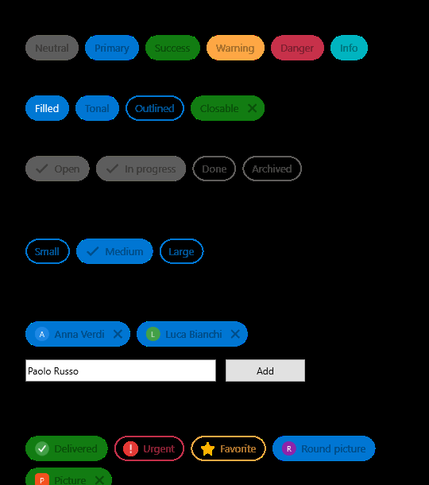

# TS4YTag and TS4YChip for FireMonkey



Two small labels, a short text on a colored background that follows the text, with an icon or a picture on the left and a close button on the right:

- **`TS4YTag`** classifies: *Urgent*, *Draft*, *Delivered*. It does not react to the mouse or the keyboard, except for its close button.
- **`TS4YChip`** is chosen by the user: a filter, a choice among a few, a recipient that can be removed. It reacts to the mouse (hover and press), to the finger and to the keyboard, can be chosen alone or in a group, and can be closed.

Both come from the same base, `TS4YCustomTag`: six meanings (`Kind`) that give the color, three ways to fill it (`Variant`), three shapes, three sizes, the colors from the style, and the same parts of the style.

Units: `Soft4You.FMX.Controls.Tag` (the base and `TS4YTag`) and `Soft4You.FMX.Controls.Chip` (`TS4YChip`), in `Sources\Tag`, with the types in `Soft4You.FMX.Controls.Tag.Types`.

## Installation

`TS4YTag` and `TS4YChip` are part of the Soft4You FMX Control Suite. They are built into the runtime package `Soft4You.FMX.Controls.Suite`, and their registration into the design-time package `SuiteD`: see the README in the root of the repository.

Add the folder `Sources\Tag` to the Delphi library path to compile your own projects with the units.

## Files

| File | Content |
|---|---|
| `Sources\Tag\Soft4You.FMX.Controls.Tag.pas` | `TS4YCustomTag` (the base, with the protected properties) and `TS4YTag` |
| `Sources\Tag\Soft4You.FMX.Controls.Chip.pas` | `TS4YChip` |
| `Sources\Tag\Soft4You.FMX.Controls.Tag.Types.pas` | The enumerated types of the kind, the variant, the shape, the size and the state, and the type of the event `OnClose` |
| `Sources\Tag\Soft4You.FMX.Controls.Tag.Register.pas` | Registration of both controls in the Tool Palette (design time) |
| `Sources\Tag\Soft4You.FMX.Controls.Tag.Win.rc` / `.Mac.rc` / `.Android.rc` / `.iOS.rc`, and the same for `Chip` | Resource scripts that link the styles as the resources `S4YTagStyle` and `S4YChipStyle` |
| `Sources\Tag\Soft4You.FMX.Controls.Tag.Win.style` / `.Mac.style` / `.Android.style` / `.iOS.style`, and the same for `Chip` | Default styles for each platform: they differ in the colors of the kinds |
| `Graphics\Tag\TS4YTag.svg`, `TS4YChip.svg` | Vector masters of the icons of the Tool Palette |
| `Graphics\Tag\TS4YTag.bmp`, `TS4YChip.bmp`, `TagDesign.rc` | Icons of the Tool Palette (24x24 bitmaps) and the resource script that links them |

The style resources are linked into the package, so the controls look the same without any other file. The packages compile them from the `.rc` files into the folder `Resources`, which your projects need in the search path of the resources, as for the other controls of the suite.

## Properties

### Content

| Property | Default | Meaning |
|---|---|---|
| `Text` | empty | The text; at design time a new control shows its name, as a label does, until a text is written |
| `Images`, `ImageIndex` | none, -1 | Image list and index of the icon on the left |
| `Bitmap` | empty | Picture on the left, for example the photo of a person; it wins over the icon. It is cut to a square, from its middle |
| `ImageRound` | `False` | Draws the `Bitmap` round instead of with slightly rounded corners |
| `Closable` | `False` | Shows a close button, a cross, on the right |

### Look

| Property | Default | Meaning |
|---|---|---|
| `Kind` | `tgkNeutral` | The meaning, that gives the color: `tgkNeutral` (gray), `tgkPrimary` (blue), `tgkSuccess` (green), `tgkWarning` (orange), `tgkDanger` (red), `tgkInfo` (light blue) |
| `Variant` | `tgvTonal` (`tgvOutlined` for a chip) | `tgvFilled`: the background has the color and the text is white or dark; `tgvTonal`: a light background of the color and text of the color; `tgvOutlined`: no background, a border and text of the color |
| `Shape` | `tgsPill` | `tgsPill` (the short sides are half circles), `tgsRounded` (corners with the radius of `CornerRadius`), `tgsSquare` |
| `CornerRadius` | 6 | Radius of the corners with `tgsRounded`, in pixels |
| `SizePreset` | `tgzMedium` | `tgzSmall` (24 pixels high), `tgzMedium` (32), `tgzLarge` (40); on Android and iOS the default is `tgzLarge` |
| `AutoSize` | `True` | The width follows the content: the text, the icon and the close button. With `False` the width is the one set, and a text that does not fit is cut |
| `BackgroundColor`, `TextColor`, `BorderColor` | `Null` | Colors that replace the ones that come from `Kind` and `Variant`; `Null` keeps them |

The height always follows `SizePreset`; the font and the spaces follow the height. The text takes its font family and style from the part `text` of the style.

### Events

| Event | When |
|---|---|
| `OnClose` | The user clicks the close button, or presses Delete or Backspace on a focused chip. `CanClose` is `True`: set it to `False` to keep the control, which is hidden otherwise |
| `OnClick`, `OnDblClick`, `OnMouseXxx` | As for every control; a click on the close button does not fire `OnClick` |

The usual `TControl` properties (`Align`, `Anchors`, `Position`, `Size`, `Margins`, `Opacity`, `Visible`, `Enabled`, `HitTest`, `Cursor`, `RotationAngle`, `Scale`, `PopupMenu`, `StyleLookup`) are published as well; `TabOrder` and `TabStop` only for the chip. A disabled control is drawn with half of its opacity.

### `TS4YChip`

| Property | Default | Meaning |
|---|---|---|
| `Checkable` | `False` | A click chooses and un-chooses the chip |
| `Checked` | `False` | The chip is chosen |
| `GroupName` | empty | Chips with the same name in the same parent are a group of which only one is chosen, as with radio buttons; clicking the chosen one keeps it chosen |
| `ShowCheckMark` | `True` | A chosen chip shows a check mark in place of its icon or picture |
| `OnCheckedChange` | | After `Checked` changes: for a click, the keyboard, the code, or another chip of the group that was chosen |

- A chosen chip is drawn with the next stronger variant (outlined becomes tonal, tonal becomes filled, filled stays filled) and with the check mark. The width can change, because of the check mark.
- States: hover (not on Android and iOS), pressed, and, on the desktop, a focus border.
- Keyboard: the chip takes the focus; Space clicks it; Delete or Backspace close it when `Closable` is `True`.
- The cursor is a hand by default.
- Changing `Checked` from the code fires `OnCheckedChange` but not `OnClick`.

## Closing

The close button fires `OnClose` and then hides the control (`Visible := False`), so that a flow layout closes the gap. To keep it, set `CanClose := False`; to remove it for good, free it later (not inside the event), for example with `TThread.ForceQueue`.

```delphi
procedure TMainForm.RecipientChipClose(Sender: TObject; var CanClose: Boolean);
begin
  Recipients.Remove(TS4YChip(Sender).Text);
end;
```

## Style

`TS4YTag` uses the style named by `StyleLookup` or, when it is empty or no style has that name, the one named `S4YTagStyle`; `TS4YChip` the one named `S4YChipStyle`. The style is looked for in the `TStyleBook` of the form, then in the active style, and the one linked into the package is the last resort. The two default styles are the same, except for the name.

The controls place and size the parts of the style themselves, so they must be direct children of the root of the style. Every part is optional.

| Part | Class | Use |
|---|---|---|
| `background` | `TRectangle` | The background: the control sets its color, its border and its radius |
| `image` | `TRectangle` | The picture (`Bitmap`) |
| `icon` | `TGlyph` | The icon taken from `Images` with `ImageIndex` |
| `check` | `TShape`, usually a `TPath` | The check mark of a chosen chip |
| `text` | `TText` | The text: font family and style; the control sets the size and the color |
| `close` | `TShape`, usually a `TCircle` | The close button: its area reacts to the mouse and to the finger; the control draws a round background on it while the mouse is over |
| `closeicon` | `TShape`, usually a `TPath`, child of `close` | The cross |
| `neutralcolor`, `primarycolor`, `successcolor`, `warningcolor`, `dangercolor`, `infocolor` | `TColorObject` | The colors of the kinds |

The colors of the background, the border and the text are calculated from the color of the kind and the variant: filled uses the color and a white or dark text, whichever is easier to read; tonal uses the color at 16 percent and a darker text; outlined uses the color for the border and a darker text. The states hover and pressed make a filled background darker and a tonal or outlined one more opaque.

## Desktop and mobile

- The mouse: hover state and hand cursor on a chip, a round highlight on the close button.
- The finger: no hover; the close button reacts in an area of at least 44 x 44 pixels, and the default size is the large one.

## Demo

`Demos\Tag\S4YTagDemo.dproj` (also part of the project group `Demos\Soft4You.FMX.Controls.Demos.groupproj`) shows the six kinds and the three variants, chips that choose several or one of a group, recipient chips with a round picture that can be closed and added, tags and chips with an icon from an image list (`Images`, `ImageIndex`) and with a picture (`Bitmap`, `ImageRound`), with the settings of a sample tag on the right. The icons and the pictures are drawn in code, so that the demo needs no image file.

The page **Chips** of the mobile gallery `Demos\Mobile` has tags, filter chips and closable chips for the phone.
